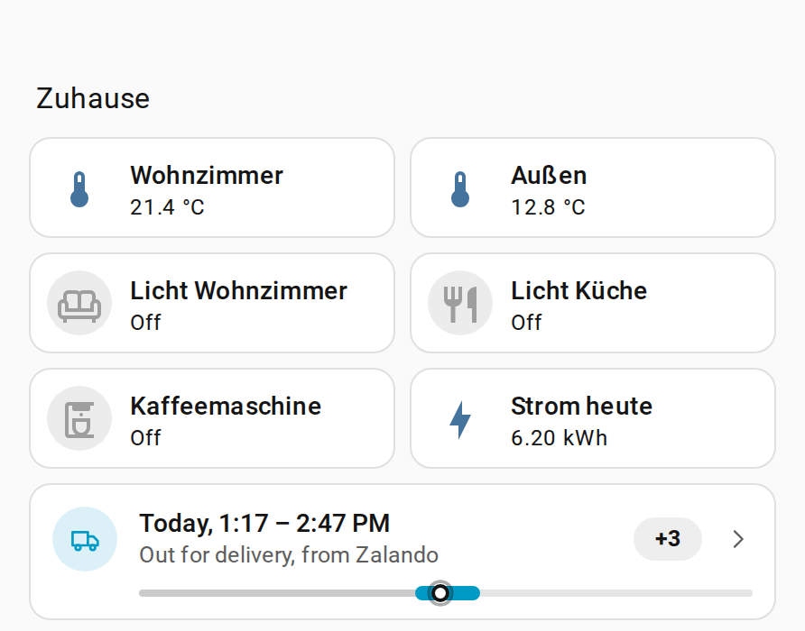
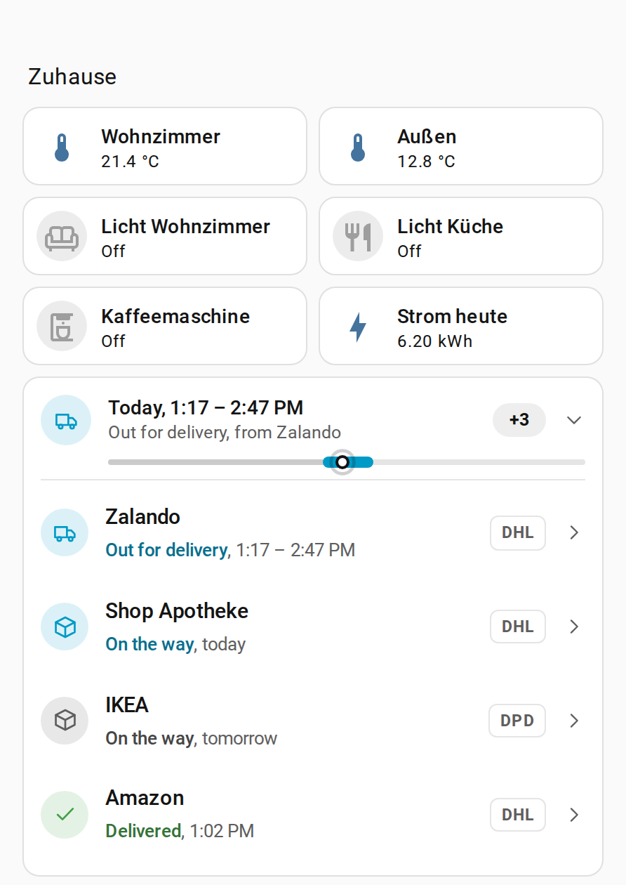
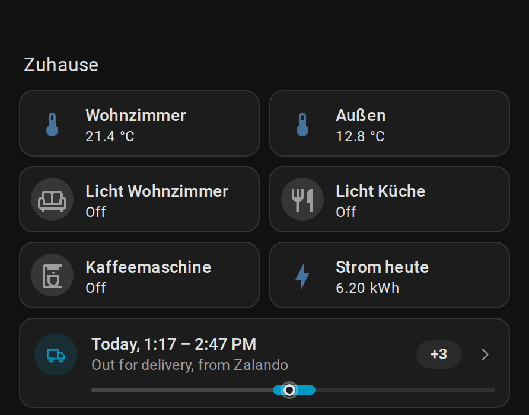
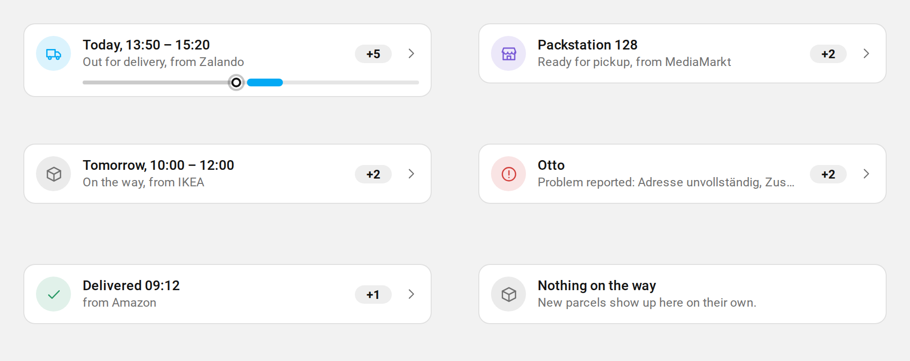
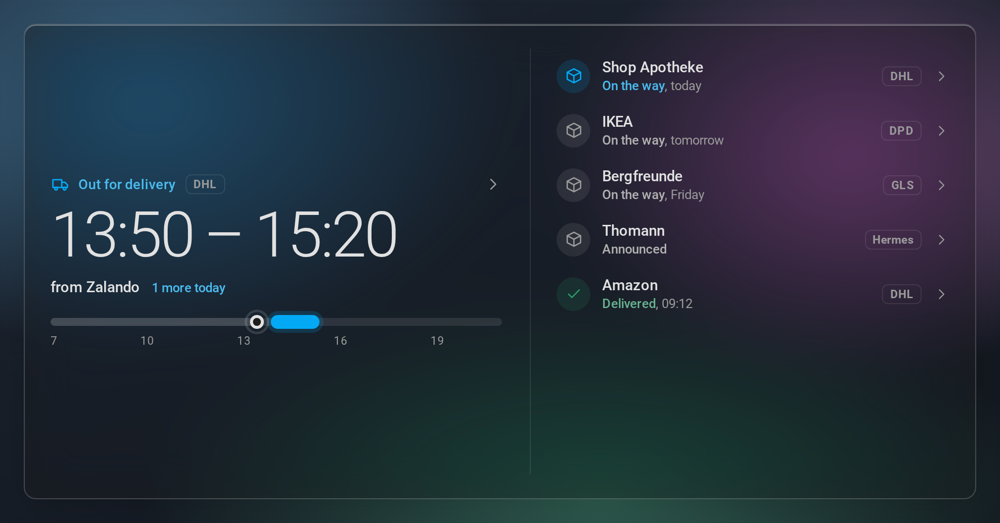

# Doorstep

A small parcel card for your Home Assistant dashboard. It sits next to your other tiles and tells you at a glance whether something arrives today, and when.



I wanted to see my parcels on my Home Assistant dashboard instead of opening a carrier app, so I built this.

Doorstep reads your parcels from the [ha-parcel-integrations](https://ha-parcel-integrations.github.io/) family (DHL, DPD, GLS, Hermes, PostNL and more) and finds them on its own. There is nothing to configure. Add the card, and it fills itself.

## What it shows

One line, like a tile: the most important parcel and the time it arrives. If something is out for delivery, a thin bar shows the delivery window next to the current time. A small counter tells you how many more parcels are on the way.

Tap the card to see every parcel. Tap a parcel for its tracking number (with a copy button), its delivery updates and a link to the carrier's tracking page.

<table>
  <tr>
    <td></td>
    <td></td>
  </tr>
</table>

The card always shows the parcel that matters most right now: out for delivery first, then parcels waiting at a Packstation or parcel shop, then problems the carrier reports, then the next delivery.



### Large size for wall panels

On a wall panel or an Echo Show running View Assist, switch the card to the large size. It then fills the screen with the delivery window in big type and the list beside it.



## Before you start

You need at least one carrier integration from [ha-parcel-integrations](https://ha-parcel-integrations.github.io/). They all publish the same parcel format, which is what Doorstep reads. If you track several carriers, or also use the [Parcel Aggregator](https://github.com/ha-parcel-integrations/ha-parcel-aggregator), Doorstep merges them and shows every parcel once.

## Install

### With HACS

[](https://my.home-assistant.io/redirect/hacs_repository/?owner=ma-2a&repository=doorstep&category=plugin)

Or by hand:

1. Open **HACS** in the sidebar.
2. Open the menu in the top right corner (three dots) and choose **Custom repositories**.
3. Paste `https://github.com/ma-2a/doorstep`, pick the type **Dashboard** and select **Add**.
4. Search for **Doorstep**, open it and select **Download**.
5. Reload your browser when HACS asks you to.

### Without HACS

1. Download `doorstep-card.js` from the [latest release](https://github.com/ma-2a/doorstep/releases/latest).
2. Copy it to `config/www/doorstep-card.js`.
3. Go to **Settings > Dashboards**, open the menu (three dots), choose **Resources** and add `/local/doorstep-card.js` as a **JavaScript module**.

## Add the card

Edit a dashboard, select **Add card** and search for **Doorstep**. That's it. The card takes the full width of a section by default. To put it next to another tile, drag its width to half in the layout tab.

In YAML:

```yaml
type: custom:doorstep-card
```

## Options

Every option is optional and can be set in the visual editor.

| Option | Default | What it does |
| --- | --- | --- |
| `size` | `compact` | `compact` is a small card for a home dashboard. `full` is the large version for wall panels. |
| `title` | none | A small label above the card. |
| `appearance` | `theme` | `theme` matches your dashboard. `glass` gives a frosted, see-through card that looks best on a background image. |
| `layout` | `auto` | Large size only. `auto` switches to side by side from 600 px width. `stacked` and `split` force one layout. |
| `show_delivered` | `true` | Keep parcels that were delivered today in the list. |
| `show_outgoing` | `false` | Also list parcels you sent, such as returns. |
| `hide_when_empty` | `false` | Hide the card while nothing is on the way. It stays visible while you edit the dashboard. |
| `max_items` | automatic | How many parcels the list shows. Automatic means 6 in the small size, 4 in the large stacked layout and all of them side by side. |
| `entities` | all | Limit the card to specific parcel sensors, for example one account. |

A home dashboard that only shows the card when something is coming:

```yaml
type: custom:doorstep-card
hide_when_empty: true
```

A wall panel:

```yaml
type: custom:doorstep-card
size: full
appearance: glass
```

## Colours

Doorstep follows your theme. The colour for today's deliveries comes from your theme's primary colour. To change any status colour, set these variables in your theme:

```yaml
doorstep-today-color: "#2a6ee8"
doorstep-pickup-color: "#7a5bd6"
doorstep-delivered-color: "#2d9a68"
doorstep-problem-color: "#d3433f"
doorstep-returning-color: "#c4841a"
doorstep-glass-opacity: 46%
```

## Languages

English, German and Dutch. Dates and times follow your Home Assistant profile, including the 12 or 24 hour setting.

## Privacy

Doorstep only reads sensor states that are already in your Home Assistant. It makes no network requests of its own.

## Try it without Home Assistant

`demo/index.html` renders the card with sample parcels. Open it in a browser and change the scenario in the address bar, for example `?scenario=pickup&theme=dark` or `?size=full&scenario=today`. Available scenarios: `today`, `pickup`, `upcoming`, `problem`, `delivered`, `empty`, `setup`, `offline`, `many`, `outgoing`, `long`, `aggregated`.

## Thanks

All the hard work of talking to the carriers happens in [ha-parcel-integrations](https://ha-parcel-integrations.github.io/). Doorstep only draws what they collect.

## Support

If Doorstep is useful to you, you can [buy me a coffee](https://ko-fi.com/ma2a).

## License

MIT
